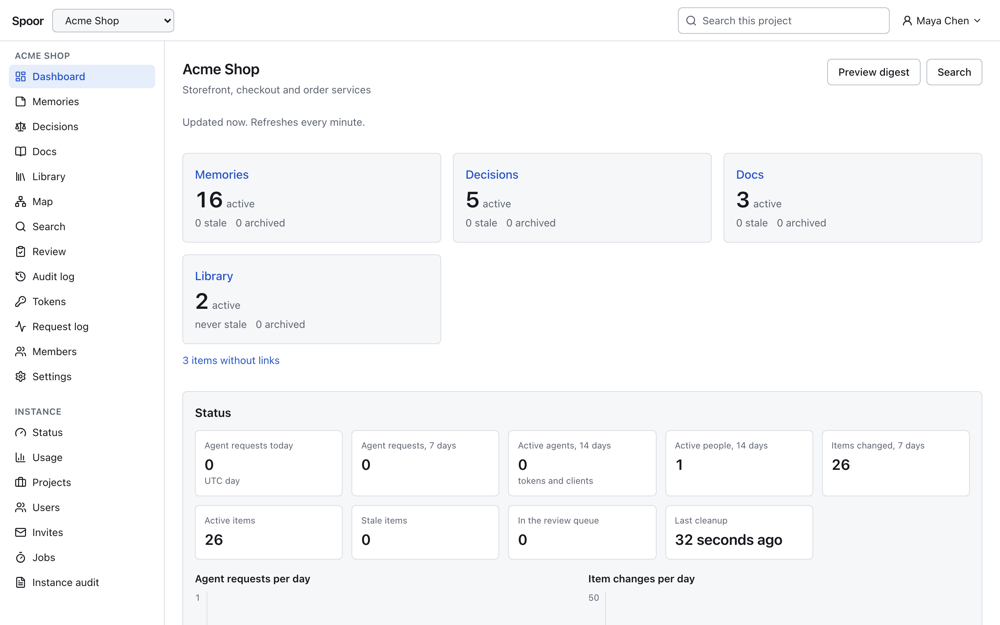
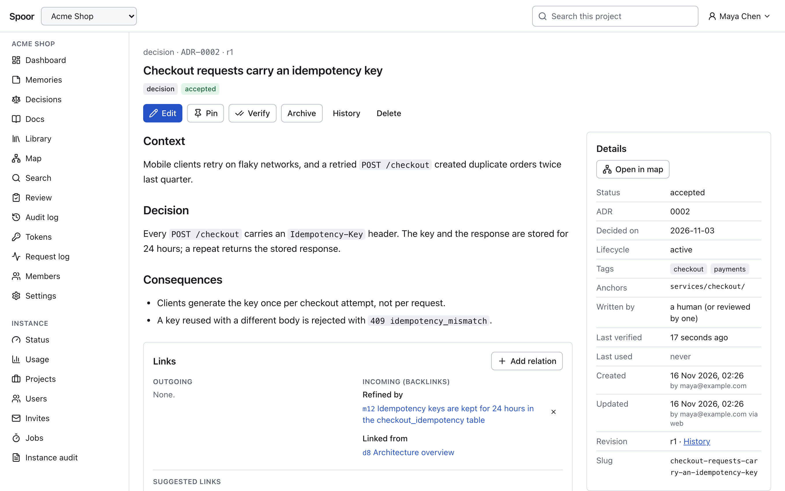
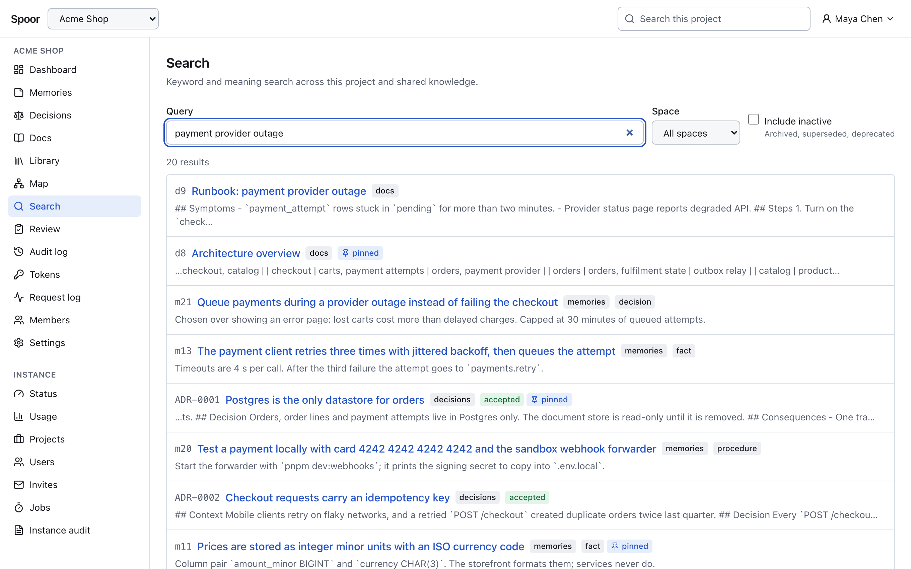
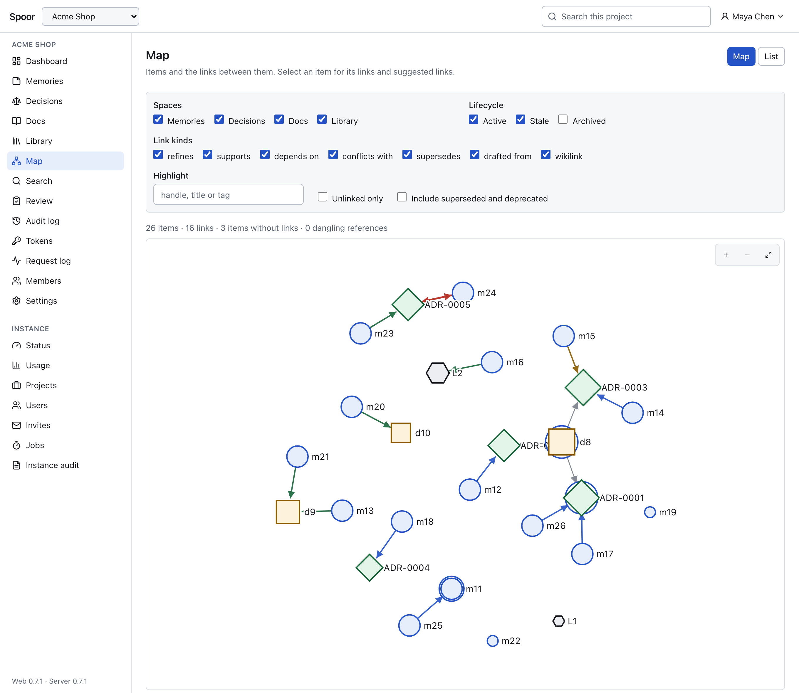
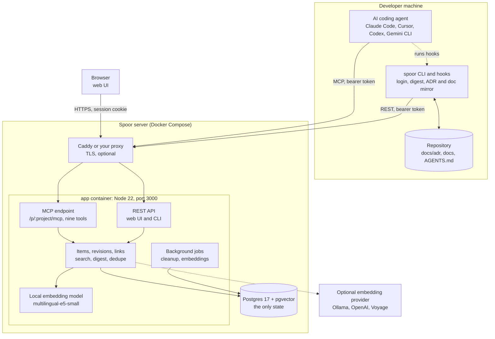

# Spoor Memory

**Self-hosted shared memory for AI coding agents and the team that works with them.**

Coding agents forget everything between sessions, and each developer's agent learns the same lessons separately. Spoor
gives a whole team one memory per project: agents read and write it over [MCP](https://modelcontextprotocol.io) at a cost
of about 1,500 tokens per session, and people browse, edit and review the same content in a web UI. What one agent learns
on Monday, every teammate's agent knows on Tuesday.

It runs as one Docker deployment (the app image plus Postgres with pgvector) on your own server. Nothing leaves it unless
you turn on an external embedding provider.



## Contents

- [What you get](#what-you-get)
- [AI tool integration](#ai-tool-integration)
- [The web UI](#the-web-ui)
- [Install the server (Docker Compose)](#install-the-server-docker-compose)
- [Install the CLI and connect a repository](#install-the-cli-and-connect-a-repository)
- [Environment variables](#environment-variables)
- [Architecture](#architecture)
- [Optional: better search with Ollama](#optional-better-search-with-ollama)
- [Operating it](#operating-it)
- [Documentation](#documentation)
- [Development](#development)

## What you get

- **Four spaces per project.** `memories` (atomic claims: decision, fact, procedure, observation), `decisions` (numbered
  ADRs, `ADR-0001`), `docs` (long-form pages) and `library` (guides written by people, which agents read but cannot
  change). Every item is Markdown with YAML frontmatter, versioned in append-only revisions.
- **A shared space** for the whole organisation. Every project's agents read it; only people write it.
- **Cheap for agents.** A budgeted digest at session start (about 1,500 tokens by default), hybrid search (full text plus
  vectors, reciprocal rank fusion), short handles such as `m42` instead of ids, one short text block per tool result.
- **Links and a map.** Items link through `[[wikilinks]]` and typed relations (`refines`, `supports`, `depends_on`,
  `conflicts_with`). Each project has an interactive graph, and Spoor suggests links between related items.
- **Self-cleaning.** Memories nobody uses or verifies go stale after 30 days and are archived 90 days later. Observations
  expire. Near-duplicates are flagged. People work through a review queue.
- **ADRs kept in step with the repository.** Decisions an agent records are drafted into `docs/adr/` as proposed ADRs on
  the developer's machine. ADR and doc files edited in the repo are pushed to Spoor.
- **Local embeddings.** A multilingual model runs inside the app container, with no API key. OpenAI, Voyage or your own
  Ollama server are optional.
- **Access control and audit.** Users, invites, three project roles (admin, editor, viewer), per-project tokens, an audit
  log and a 14-day log of agent requests.
- **Export and import** of a project as a zip of Markdown files with full history.

Spoor is single tenant by design: one deployment serves one organisation with many isolated projects.

## AI tool integration

Each project has one MCP endpoint, `https://<your-server>/p/<project>/mcp` (Streamable HTTP, bearer token). Any MCP client
that can send an `Authorization` header can use it.

### Supported tools

| tool | memory tools (MCP) | digest at session start | ADR and doc mirror | setup |
|---|---|---|---|---|
| **Claude Code** | yes | automatic (hook) | automatic (hooks) | `spoor login`, which writes everything |
| **Cursor** | yes | the agent calls `spoor_context` | manual (`spoor adr draft`, `spoor adr push`) | `.cursor/mcp.json` |
| **Codex** | yes | the agent calls `spoor_context` | manual | `.codex/config.toml` |
| **Gemini CLI** | yes | the agent calls `spoor_context` | manual | `.gemini/settings.json` |
| other MCP clients | yes, with Streamable HTTP and a bearer header | the agent calls `spoor_context` | manual | endpoint and token |

Claude Code is the fully integrated client. The others get the same nine tools; they have no hooks, so a block in
`AGENTS.md` (written by `spoor init`) tells the agent when to read and write memory. A client that reads a different
rules file needs that block copied into it.

### The nine MCP tools

| tool | kind | what it does |
|---|---|---|
| `spoor_context` | read | the budgeted digest for the files being touched and an optional query |
| `spoor_search` | read | hybrid keyword and meaning search over memories, ADRs, docs and library pages |
| `spoor_get` | read | up to five items in full, optionally with their linked neighbourhood |
| `spoor_remember` | write | record one durable fact, procedure or observation |
| `spoor_decide` | write | record a decision; an ADR is drafted from it later |
| `spoor_doc_write` | write | create or update a long-form doc |
| `spoor_supersede` | write | replace an outdated memory with a new claim |
| `spoor_relate` | write | add or remove a typed link between two items |
| `spoor_verify` | write | confirm memories are still true |

Tokens belong to one user and one project and follow that user's role: editors and admins get all nine tools, viewers and
read-only tokens get the three read tools.

### Claude Code

`spoor login` (see [below](#install-the-cli-and-connect-a-repository)) sets up the MCP server and three hooks:

- **Session start**: the project digest is added to the context. It holds library pages, pinned items, recent accepted
  decisions, items anchored to the files you are changing, and recently verified items.
- **After a Write or Edit** of an ADR or a mirrored doc: the file is pushed to Spoor.
- **Turn end**: decisions recorded with `spoor_decide` are drafted into `docs/adr/` as `status: proposed`, by a small
  model on your machine. If the session changed files and recorded nothing, the agent is asked once to record its
  decisions.

Hooks never block a session: if the server is down they print one notice and exit.

### Other clients

Create a token in the web UI (Project, Tokens) and put it in an environment variable, one per project
(`SPOOR_TOKEN_ACME` for the project `acme`). Never commit the token.

Cursor, `.cursor/mcp.json`:

```json
{
  "mcpServers": {
    "spoor": {
      "url": "https://spoor.example.com/p/acme/mcp",
      "headers": { "Authorization": "Bearer ${env:SPOOR_TOKEN_ACME}" }
    }
  }
}
```

Codex, `.codex/config.toml` in the repo (trusted projects only) or `~/.codex/config.toml`:

```toml
[mcp_servers.spoor-acme]
url = "https://spoor.example.com/p/acme/mcp"
bearer_token_env_var = "SPOOR_TOKEN_ACME"
```

Gemini CLI, `.gemini/settings.json`:

```json
{
  "mcpServers": {
    "spoor": {
      "httpUrl": "https://spoor.example.com/p/acme/mcp",
      "headers": { "Authorization": "Bearer $SPOOR_TOKEN_ACME" }
    }
  }
}
```

Every project also serves a public, secret-free install page at `https://<your-server>/p/<project>/install.md` with these
snippets filled in. Details: [docs/agent-guide.md](docs/agent-guide.md).

## The web UI

The web UI is where people read, correct and administer what agents write. Open the server's URL in a browser and log in.

**Dashboard.** Counts per space, what waits for review, agent activity, and a preview of the digest agents receive.

**Items.** Each memory, decision, doc and library page renders as Markdown with its tags, anchors (the repo paths it
applies to), links, backlinks and suggested links. Edit in a Markdown editor with live preview; every save is a revision
with a diff.



**Search.** The same hybrid keyword and meaning search agents use, across the project and the shared space.



**Map.** The project as a graph of items and links, with filters by space, lifecycle and link kind, a focus mode for one
item's neighbourhood, and counts of unlinked items and dangling references.



**Review queue.** Stale and archived items, expiring observations, conflicts and possible duplicates, with bulk verify and
archive.

**Administration.** Members and roles, invites (a copyable link, no email server needed), tokens, device approval for
`spoor login`, project settings (digest budget, cleanup periods, embedding provider), export and import, the audit log, the
agent request log, and instance pages for status, usage and background jobs.

Full tour: [docs/user-guide.md](docs/user-guide.md).

## Install the server (Docker Compose)

You need Docker with the compose plugin, 2 CPUs and about 2 GB of memory for the app container.

```sh
git clone https://github.com/SPECTADO/spoor-memory.git && cd spoor-memory
cp .env.example .env
```

Edit `.env` and set at least:

| variable | value |
|---|---|
| `POSTGRES_PASSWORD`, `POSTGRES_APP_PASSWORD` | two random URL-safe strings: `openssl rand -hex 24` |
| `SPOOR_ADMIN_EMAIL` | your email, the first admin login |
| `SPOOR_ADMIN_PASSWORD` | at least 12 characters |
| `SPOOR_PUBLIC_URL` | the URL people will type, `http://localhost:3000` for a local trial |
| `SPOOR_IMAGE` | `ghcr.io/spectado/spoor-memory:0.7.1` to run the published image (recommended) |

Start it with the published image:

```sh
docker compose pull && docker compose up -d
curl -s localhost:3000/healthz   # {"status":"ok",...} once migrations ran and the model loaded (up to two minutes)
```

Or build the image from the checkout: leave `SPOOR_IMAGE` at its default and run `docker compose up -d --build`.

Compose starts two containers: `db` (Postgres 17 with pgvector, data in the `spoor-pgdata` volume) and `app` (API, MCP
endpoint and web UI on port 3000). Postgres is the only state.

**Image tags** at `ghcr.io/spectado/spoor-memory`:

| tag | what it is |
|---|---|
| `x.y.z`, `x.y` (e.g. `0.7.1`, `0.7`) | a release. Use this in production |
| `latest` | the highest release |
| `develop` | the newest commit on `main` that passed CI |
| `sha-<short>` | one specific `main` build, for pinning or rolling back |

**HTTPS.** Agents and browsers should reach Spoor over HTTPS. The compose file includes an optional Caddy service that
gets a Let's Encrypt certificate (ports 80 and 443 open, DNS pointing at the host):

```sh
# .env
SPOOR_DOMAIN=spoor.example.com
SPOOR_PUBLIC_URL=https://spoor.example.com
SPOOR_HTTP_BIND=127.0.0.1
SPOOR_TRUST_PROXY=private
```

```sh
docker compose --profile caddy up -d
```

For nginx, Traefik or a load balancer of your own, see [docs/operations.md](docs/operations.md), section 4.

**First steps.**

1. Open `SPOOR_PUBLIC_URL` and log in with `SPOOR_ADMIN_EMAIL` and `SPOOR_ADMIN_PASSWORD`. This admin is created only
   while the user table is empty.
2. Create a project: Projects, New project, a name and a slug (`acme`; the slug is permanent).
3. Invite teammates under Admin, Invites, and give each a role on the project.

## Install the CLI and connect a repository

The `spoor` CLI connects a repository to a project. Every developer installs it once (Node 22 or later):

```sh
npm i -g spoor-memory@0.7.1        # use the version of your server
```

Then, in the root of the repository:

```sh
spoor login --server https://spoor.example.com --project acme
```

`spoor login` prints a URL and an 8-letter code. Open the URL, log in and approve the code. The command then:

- stores the token in `.claude/settings.local.json` (mode 0600, added to `.gitignore`);
- writes `.mcp.json` and the Claude Code hooks in `.claude/settings.json`, with no secret in either;
- adds a Spoor block to `AGENTS.md` and an `@AGENTS.md` import to `CLAUDE.md`;
- turns Claude Code's own auto-memory off for this repo, so Spoor is the one memory (a project setting).

Restart Claude Code and approve the `spoor` MCP server. Then bring in what the repository already has:

```sh
spoor adr import       # docs/adr/*.md become decisions
spoor docs import      # ARCHITECTURE.md, GLOSSARY.md, docs/*.md become docs
spoor status --remote  # project, role, token expiry
spoor context --git    # the digest an agent will get
```

Commit `.mcp.json`, `.claude/settings.json`, `AGENTS.md` and the ADR files. A teammate on a repository that is already
set up only installs the CLI and runs `spoor login`.

**Or let the agent do it.** Tell Claude Code in the repository:

> Set up Spoor memory by following `https://spoor.example.com/p/acme/install.md`

**Updates.** The CLI does not update itself. After a server upgrade, the session digest names the new version: run
`npm i -g spoor-memory@<server version>`, then `spoor init` in each repo.

All commands and options: [packages/cli/README.md](packages/cli/README.md).

## Environment variables

### Server

`.env.example` is the annotated template. Compose reads `.env`; a variable left empty takes its default.

Read by Docker Compose only:

| variable | default | meaning |
|---|---|---|
| `POSTGRES_PASSWORD` | required | password of the `spoor` database superuser, used at startup only. URL-safe characters |
| `POSTGRES_APP_PASSWORD` | required | password of the `spoor_app` runtime role. Set when the volume is first created; changing it later has no effect |
| `SPOOR_IMAGE` | `spoor-memory:local` | app image. The default is the local build; set `ghcr.io/spectado/spoor-memory:<version>` to pull |
| `SPOOR_HTTP_PORT` | `3000` | host port of the app |
| `SPOOR_HTTP_BIND` | `0.0.0.0` | host address of the app. Use `127.0.0.1` behind a reverse proxy |
| `SPOOR_DOMAIN` | `localhost` | host name for the Caddy profile |

Read by the app:

| variable | default | meaning |
|---|---|---|
| `SPOOR_PUBLIC_URL` | `http://localhost:3000` | the origin users type, with no path. Drives the origin check, cookie flags and every link. A mismatch breaks logins |
| `SPOOR_ADMIN_EMAIL`, `SPOOR_ADMIN_PASSWORD` | required on an empty database | the first instance admin. Password 12 to 256 characters. Ignored once a user exists |
| `SPOOR_ADMIN_NAME` | `Admin` | display name of that admin |
| `LOG_LEVEL` | `info` | `trace`, `debug`, `info`, `warn`, `error` or `fatal`. JSON lines on stdout |
| `SPOOR_EMBEDDING_DEFAULT` | `local` | embedding provider new projects start with: `local`, `openai`, `voyage` or `ollama` |
| `SPOOR_EMBED_THREADS` | `2` | CPU threads of the local model (1 to 64) |
| `SPOOR_OPENAI_API_KEY` | unset | enables the `openai` provider. Item text is then sent to OpenAI |
| `SPOOR_OPENAI_EMBED_MODEL`, `SPOOR_OPENAI_EMBED_DIMS` | `text-embedding-3-small`, `1536` | OpenAI model and vector size |
| `SPOOR_VOYAGE_API_KEY` | unset | enables the `voyage` provider. Item text is then sent to Voyage |
| `SPOOR_VOYAGE_EMBED_MODEL`, `SPOOR_VOYAGE_EMBED_DIMS` | unset | required when the Voyage key is set |
| `SPOOR_OLLAMA_URL` | unset | enables the `ollama` provider. Item text is sent to that Ollama server |
| `SPOOR_OLLAMA_EMBED_MODEL`, `SPOOR_OLLAMA_EMBED_DIMS` | `embeddinggemma`, `768` | Ollama model and vector size |
| `SPOOR_TRUST_PROXY` | unset | reverse proxies whose `X-Forwarded-For` is believed: `loopback`, `private`, addresses or CIDR ranges, comma-separated. Affects only the address shown on the device approval page |
| `SPOOR_UPDATE_CHECK` | `on` | every 6 hours the server reads one small file from GitHub and tells admins about a new release. It sends no instance data. `off` stops it |
| `SPOOR_UPDATE_URL` | the release file in this repository | where the update check reads from |
| `SPOOR_PUSH_CONCURRENCY` | `3` | repo pushes and imports in flight per project (1 to 64). More get `503 busy` |
| `SPOOR_JOBS` | `on` | `off` disables the background scheduler (cleanup, embeddings, usage samples) |
| `SPOOR_DB_POOL_MAX` | `10` | maximum Postgres connections (1 to 500) |

Set by Compose or the image. Change these only when you run the app without the compose file:

| variable | default | meaning |
|---|---|---|
| `DATABASE_URL` | required | Postgres URL of the runtime role (no superuser) |
| `DATABASE_MIGRATE_URL` | unset | superuser URL, used once at startup for `CREATE EXTENSION`. Unset: the `vector` and `unaccent` extensions must exist already |
| `SPOOR_PORT`, `SPOOR_HOST` | `3000`, `0.0.0.0` | listen port and address inside the container |
| `SPOOR_MODEL_DIR` | `/opt/spoor/models` | where the local embedding model lives |
| `SPOOR_WEB_DIR`, `SPOOR_MIGRATIONS_DIR` | set by the image | paths of the built web UI and the migrations |
| `NODE_ENV` | `production` in the image | do not change |

Docker secrets: `DATABASE_URL`, `DATABASE_MIGRATE_URL`, `SPOOR_ADMIN_PASSWORD`, `SPOOR_OPENAI_API_KEY` and
`SPOOR_VOYAGE_API_KEY` also accept a `<NAME>_FILE` variant that names a file holding the value. Setting both is a
startup error.

### CLI

`spoor login` stores the first three in `.claude/settings.local.json`, so you rarely set them by hand.

| variable | meaning |
|---|---|
| `SPOOR_URL`, `SPOOR_PROJECT`, `SPOOR_TOKEN` | server URL, project slug and token. They override the stored values |
| `SPOOR_DISABLE=1` | every hook and `spoor adr draft` do nothing |
| `SPOOR_DRAFT_CMD` | shell command that drafts an ADR, in place of the default `claude -p --model haiku` |
| `SPOOR_IMPORT_TIMEOUT_MS` | fixed per-request timeout of `adr import` and `docs import` (100 to 600000) |
| `CI` | when set, ADR drafting is skipped unless `spoor.config.json` sets `draft.in_ci: true` |

## Architecture



- **One app container** serves the MCP endpoint, the REST API and the web UI. It keeps nothing on disk; the embedding
  model is baked into the image.
- **Postgres with pgvector** holds everything: items, revisions, links, full-text and vector indexes, users, tokens and
  the audit log. Back it up with `pg_dump`.
- **Agents** authenticate with per-project bearer tokens; **people** with a session cookie. Agents cannot write to the
  shared space or to library pages.
- **Search** fuses Postgres full-text search with vector search. The digest is assembled from the same data within a
  fixed token budget.
- **The CLI** runs on the developer's machine: it logs in through a device code, feeds the digest to Claude Code through
  hooks, and mirrors ADR and doc files to the server.

Components, flows and reasons: [ARCHITECTURE.md](ARCHITECTURE.md), [GLOSSARY.md](GLOSSARY.md) and the decision records in
[docs/adr/](docs/adr/README.md).

## Optional: better search with Ollama

The built-in model needs nothing. For better recall on reworded and non-English questions, Spoor can embed with
`embeddinggemma` on an [Ollama](https://ollama.com) server instead (paraphrase MRR 0.78 against 0.48 on our benchmark,
[ADR-0026](docs/adr/README.md)). Item text is then sent to that Ollama server and nowhere else.

1. **Add an Ollama service.** Create `docker-compose.override.yml` next to `docker-compose.yml` (compose merges it
   automatically):

   ```yaml
   services:
     ollama:
       image: ollama/ollama:0.40.15
       restart: unless-stopped
       environment:
         OLLAMA_KEEP_ALIVE: "-1" # keep the model loaded, so no search waits for a reload
       volumes:
         - ollama-models:/root/.ollama
       # no ports: only the app reaches it, on the compose network (Ollama has no authentication)

   volumes:
     ollama-models:
   ```

2. **Point Spoor at it.** In `.env`:

   ```sh
   SPOOR_OLLAMA_URL=http://ollama:11434
   ```

   `SPOOR_OLLAMA_EMBED_MODEL` (`embeddinggemma`) and `SPOOR_OLLAMA_EMBED_DIMS` (`768`) already have the right defaults.

3. **Start it and pull the model** (about 620 MB, once; it stays in the `ollama-models` volume):

   ```sh
   docker compose up -d
   docker compose exec ollama ollama pull embeddinggemma
   ```

4. **Switch a project.** In the web UI open the project's Settings, Embedding, choose `ollama` and save. Items are
   re-embedded in the background; search keeps using the old model until the switch. To start new projects on it, also set
   `SPOOR_EMBEDDING_DEFAULT=ollama` in `.env`.

5. **Check the duplicate settings only if you had changed them.** embeddinggemma scores similar texts lower than the
   built-in model, so a project on it defaults to a duplicate threshold of 0.75 and a related-items floor of 0.50 instead
   of 0.87 and 0.70. Values you saved earlier under Settings, Duplicates are kept as they are and belong to the old
   model's scale: set them again after the switch.

Notes:

- **GPU.** The service above runs on CPU, which is slower than the built-in model for bulk re-embedding; its speed has not
  been measured. With an NVIDIA GPU and the NVIDIA container toolkit, add
  `deploy: { resources: { reservations: { devices: [{ driver: nvidia, count: all, capabilities: [gpu] }] } } }` to the
  `ollama` service.
- **macOS.** Docker gives containers no GPU there. Skip step 1, run the Ollama app natively (`ollama pull embeddinggemma`)
  and set `SPOOR_OLLAMA_URL=http://host.docker.internal:11434`.
- **If Ollama is down**, writes still succeed (their embeddings are retried every minute) and search falls back to full text.

Details and other models: [docs/operations.md](docs/operations.md), section 7.

## Operating it

- **Backup.** `docker compose exec -T db pg_dump -U spoor -Fc spoor > spoor-$(date +%F).dump`. The file holds password
  and token hashes, so treat it as a secret. A project can also be exported as a zip from its Settings page.
- **Upgrade.** Back up, set the new version in `SPOOR_IMAGE`, then `docker compose pull && docker compose up -d`.
  Migrations run at startup and are forward-only; to roll back, restore the dump and start the older image.
- **Health.** `GET /healthz` reports the database, migrations and the embedding model. Instance admins see status, usage
  and job pages in the web UI.
- **Rate limiting** belongs in your reverse proxy; the app has none of its own.
- **Outbound traffic.** With the local embedding provider, the only call the server makes on its own is the update
  check, which `SPOOR_UPDATE_CHECK=off` stops.

TLS, proxies, restore, troubleshooting and releasing: [docs/operations.md](docs/operations.md).

## Documentation

| read | for |
|---|---|
| [docs/operations.md](docs/operations.md) | deploying and running it: env vars, TLS, proxies, backup, restore, upgrades, troubleshooting |
| [docs/user-guide.md](docs/user-guide.md) | the web UI: projects, spaces, the map and suggested links, item lifecycle, editing, tokens, admin |
| [docs/agent-guide.md](docs/agent-guide.md) | what agents get: digest, tools, links, hooks, drafting, mirror rules, token costs |
| [packages/cli/README.md](packages/cli/README.md) | the CLI: commands, configuration, imports |
| [CHANGELOG.md](CHANGELOG.md) | what is in each release |
| [ARCHITECTURE.md](ARCHITECTURE.md), [GLOSSARY.md](GLOSSARY.md) | components, flows, terms |
| [docs/adr/](docs/adr/README.md), [docs/design/](docs/design/) | decisions and the detailed design; [dod-status.md](docs/design/dod-status.md) maps the brief's Definition of done to evidence |
| [BRIEF.md](BRIEF.md) | the contract: scope and amendments |

## Development

Node 22 and pnpm 10.34.7 (`packageManager`). `pnpm install`, then `pnpm build`, `pnpm test`, `pnpm lint`, `pnpm typecheck`.

The server's integration and end-to-end tests need Postgres with pgvector: `pnpm test:db:up` starts one in Docker on port 55432
(`pnpm test:db:down` removes it), or point `DATABASE_URL` at a database whose name ends in `_test`. `pnpm test` fails fast
with a clear message when it is unreachable; `pnpm --filter @spoor/server test:e2e` walks the CLI against the real server.
`pnpm e2e` builds and runs the Playwright browser tests (once: `pnpm --filter @spoor/web exec playwright install chromium`).
`pnpm --filter "spoor-memory..." build && pnpm --filter spoor-memory test:pack` checks the npm package as it would be published.
Releases are cut with a `v*` tag ([operations §10](docs/operations.md), ADR 0013); every green push to `main` also publishes
the `develop` image (ADR 0019).
Package notes: [server](packages/server/README.md), [web](packages/web/README.md), [CLI](packages/cli/README.md).

## Licence

MIT, see [LICENSE](LICENSE).
